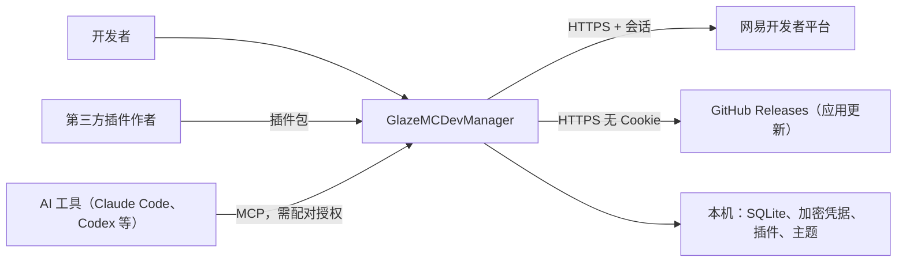

# 01 总览

## 背景

[MCDevManager](https://github.com/BitterLemonn/MCDevManager) 是一个用 Kotlin Multiplatform 写的网易我的世界开发者管理客户端，覆盖作品管理、数据分析、收益结算、玩家反馈、评论、消息和多账号管理。它的业务价值已经验证，但存在几个结构性问题：

- 网易 Cookie 会随 GitHub 更新请求发往其他域；密码和 Cookie 明文落盘，部分日志会输出 Cookie。
- 收益查询失败时被当成零收入展示。
- 多账号只有一份全局会话，换号失败不回滚，旧请求可能污染新账号。
- ViewModel 手工创建，后台轮询可能泄漏；测试没有进入 CI。
- 界面和业务耦合，无法自由排版、换主题或扩展。

GlazeMCDevManager **参考其业务和接口，重新设计和实现**，只做 Windows 版。

## 目标

1. 覆盖原项目的核心业务：账号、首页概览、作品、数据分析、收益结算、反馈与评论、消息。
2. **模块化**：每个业务模块是独立插件，可以单独开发、测试、启用和禁用。
3. **排版自由**：页面由组件组成，用户可以调整布局并恢复默认。
4. **主题可扩展**：新增一套主题只需要一个主题包，不改组件代码。
5. **开放插件**：第三方可以开发主题和功能插件，并在受控权限内运行。
6. **凭据安全**：从架构上保证凭据不外泄，而不是靠约定。
7. **AI 工具可接入**：每个功能先定义为能力，外部 AI 工具可以通过 MCP 在授权范围内调用。见 [13 能力层与 MCP 接入](13-mcp.md)。

## 非目标（当前阶段）

- macOS、Linux、移动端。
- 内置 AI、3D 实体预览、资源包编辑器。架构上不阻断，但不在当前范围。
- 自建服务器。所有逻辑都在本机运行，直接请求网易平台。
- 插件市场的在线分发与审核（第三方插件先支持本地安装）。

## 约束

| 约束 | 说明 |
|---|---|
| 平台接口 | 网易开发者平台没有公开 API 文档，接口和登录协议从原项目迁移，随时可能变化 |
| 许可证 | 原项目采用自定义 BNCL-1.0（源码可见、非商业、修改版需同许可证）。**本项目不复制原项目源码**，只参考其行为和接口，自行实现 |
| 运行环境 | Windows 10/11，x64 |
| 团队规模 | 个人或小团队维护，架构要简单可落地，避免过度设计 |

## 质量属性（按优先级）

1. **安全性**：凭据只在主进程，插件按权限访问。
2. **数据正确性**：查询失败必须显式呈现，不能静默降级成零或空。
3. **可扩展性**：新增模块、主题、组件不需要改宿主代码。
4. **可维护性**：网易接口变化时，只改 `@glaze/netease` 一处。
5. **可测试性**：核心逻辑（登录协议、收益规则、会话切换）可以脱离界面测试。
6. **性能**：插件按需激活，组件按需加载；冷启动目标 3 秒内显示首屏。

## 系统上下文

## 术语

| 术语 | 含义 |
|---|---|
| 宿主（Shell） | 应用外壳：窗口、导航、启动判定、布局与主题引擎、插件管理 |
| 插件（Plugin） | 通过清单声明贡献内容的功能单元；内置模块也是插件 |
| 贡献点（Contribution Point） | 插件可以扩展的位置：页面、导航项、组件、命令、设置等 |
| 组件（Widget） | 可放进页面布局的界面块，例如"当前账号"卡片 |
| 布局文档（Layout） | 描述某页面有哪些组件、在网格中的位置和大小的 JSON |
| 设计令牌（Token） | 主题中的命名样式值，例如 `action.primary.bg` |
| 主题包（Theme） | 一组令牌、图标和字体，决定应用外观 |
| 端点（Endpoint） | 网易接口的一个调用项，有固定 ID、权限范围和数据结构 |
| 会话（Session） | 某个网易账号的登录状态（Cookie 集合） |
| 能力（Capability） | 一个有契约的业务操作，界面、插件、MCP 都通过它调用功能 |
| MCP 客户端 | 通过 MCP 接入的外部 AI 工具，是一种需要配对授权的调用者 |
