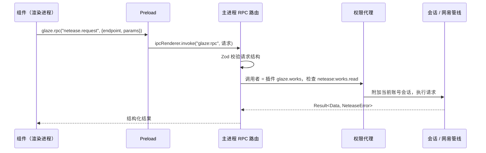
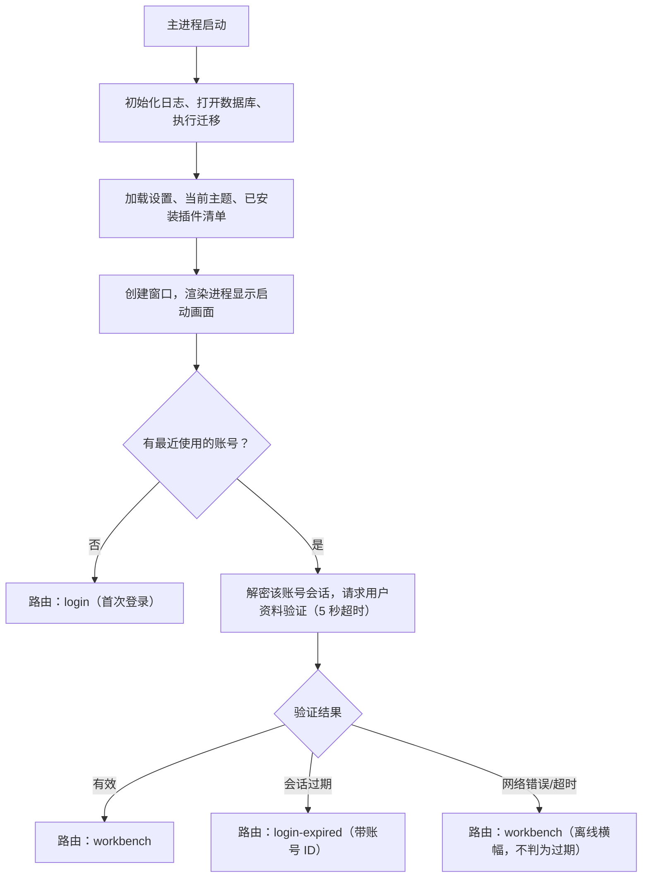

# 02 进程模型与启动流程

## 进程划分

| 进程 | 运行内容 | 能力 | 不能做的事 |
|---|---|---|---|
| 主进程 | 应用生命周期、窗口、RPC 路由、权限代理、插件注册表、会话管理、网易请求管线、存储、更新 | 完整 Node.js | 不渲染界面，不执行第三方代码 |
| Preload | 通过 `contextBridge` 暴露 `window.glaze.rpc` 和事件订阅 | 只转发 | 不暴露任何 Node API |
| 渲染进程 | Shell、布局引擎、主题引擎、内置插件界面 | 浏览器环境 | 不能访问文件、网络（除本地资源协议）、凭据 |
| 插件宿主进程 | 第三方插件的逻辑部分（`utilityProcess`） | 只能调用宿主提供的 RPC | 不能直接访问 Node 内置模块（加载时禁用） |
| 沙箱 iframe | 第三方插件的自定义界面 | `postMessage` 桥 | 无同源权限、无 Node、受 CSP 约束 |

一个原则贯穿始终：**所有有副作用的能力都在主进程，其他进程都通过 RPC 请求，主进程按调用者身份检查权限。**

## 通信

- 渲染进程只有一个 RPC 通道 `glaze:rpc`（请求/响应）和一个事件通道 `glaze:event`（主进程推送）。
- 每个请求都带调用者身份：Shell 本身，或某个插件 ID。插件身份由宿主在加载插件时注入，插件自己无法伪造。
- 插件宿主进程通过 `MessagePort` 连接主进程，协议与渲染进程相同。

详细契约见 [09 IPC 与契约](09-ipc-and-contracts.md)。

## 启动流程

启动时要决定第一个界面：**首次登录**、**登录已过期**，还是**直接进入工作台**。

要点：

- 启动判定由主进程的会话管理完成，渲染进程通过 `app.getInitialRoute()` 获取结果，不自己猜。
- **网络错误不等于会话过期**。原项目手动换号时会把网络失败判为过期，这里明确区分。
- 判定期间显示启动画面，同时并行加载主题和内置插件，避免串行等待。
- 关闭"启动时自动登录"后，有已保存账号也进入 `login-expired` 页面让用户选择，但不发验证请求。

## 窗口

- 单主窗口，自定义标题栏（无边框窗口 + 自绘最小化、最大化、关闭）。
- 记住窗口大小、位置和最大化状态。
- 后续如需独立窗口（例如插件详情页），由 Shell 统一创建，复用同一套 preload 和安全设置。
