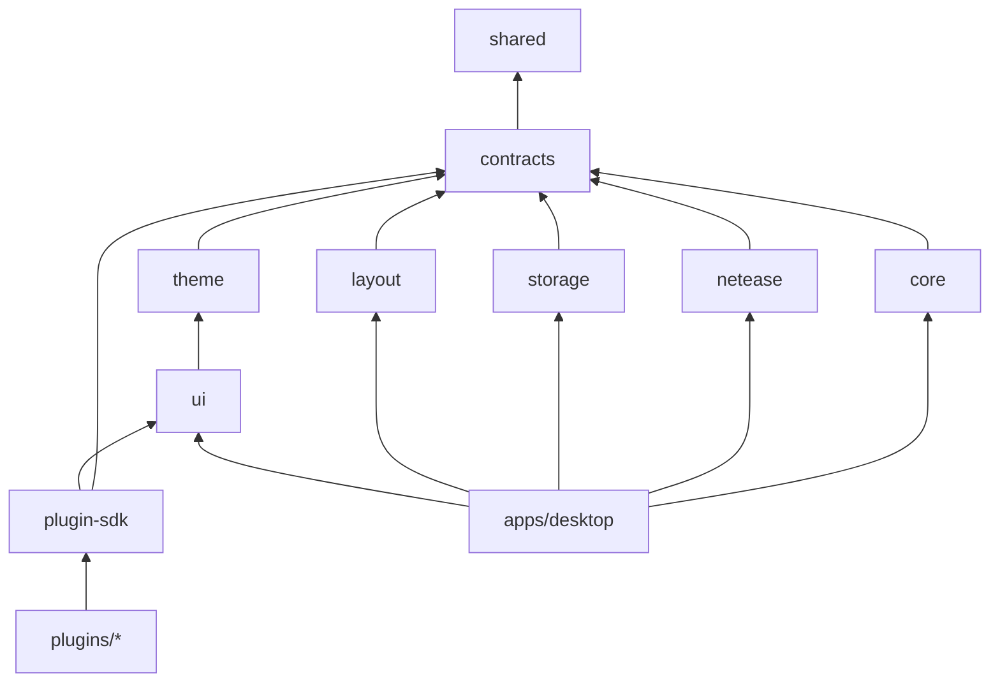

# 03 模块与依赖规则

## 仓库结构

```
GlazeMCDevManager/
├─ apps/
│  └─ desktop/                 Electron 应用
│     ├─ src/main/             主进程：bootstrap、windows、ipc、protocol
│     ├─ src/preload/          contextBridge 暴露 window.glaze
│     ├─ src/renderer/         Shell：shell、routes、startup
│     └─ resources/            应用图标、安装包资源
├─ packages/
│  ├─ shared/                  Result、错误基类、ID、工具函数
│  ├─ contracts/               RPC、插件 API、事件的 Zod 契约
│  ├─ core/                    插件注册表、插件宿主进程管理、权限代理、事件总线、资源协议
│  ├─ netease/                 登录协议、会话管理、端点目录、请求管线、上传
│  ├─ storage/                 SQLite、迁移、凭据保险箱
│  ├─ theme/                   主题包校验、token 解析、CSS 变量、图标注册
│  ├─ layout/                  布局文档、组件注册、网格编辑、用户覆盖
│  ├─ ui/                      基础组件库（只读 token）
│  └─ plugin-sdk/              对外发布的插件 SDK
├─ plugins/                    内置插件
│  ├─ home/  account/  works/  analytics/
│  └─ income/  community/  messages/  settings/
├─ themes/
│  ├─ ore-ui/                  默认主题
│  └─ fluent-dark/             第二套主题（验证 token 体系）
├─ tools/                      插件打包、主题校验、依赖边界检查等脚本
├─ tests/e2e/                  Playwright 端到端测试
└─ docs/
   ├─ architecture/            本文档
   ├─ adr/                     架构决策记录
   └─ design/references/       设计参考图
```

## 包职责与运行位置

| 包 | 运行位置 | 职责 | 对外暴露 |
|---|---|---|---|
| `@glaze/shared` | 任意 | 纯类型和纯函数，无副作用、无平台依赖 | `Result`、`AppError`、工具函数 |
| `@glaze/contracts` | 任意 | 所有跨进程、跨边界的数据结构定义 | Zod schema 和推导出的类型 |
| `@glaze/core` | 主进程 | 插件发现与加载、权限判定、事件总线、`glaze-asset://` 协议 | 内核服务接口 |
| `@glaze/netease` | 主进程 | 网易登录与接口调用，会话持有者 | `SessionManager`、`NeteaseClient` |
| `@glaze/storage` | 主进程 | 数据库连接、迁移、加密字段 | 仓储接口 |
| `@glaze/theme` | 渲染进程（校验部分任意） | 主题包解析、继承、变体合并，输出 CSS 变量 | `ThemeEngine`、`validateTheme` |
| `@glaze/layout` | 渲染进程 | 布局文档读写、组件注册、网格编辑 | `LayoutEngine`、`<PageGrid>` |
| `@glaze/ui` | 渲染进程 | 按钮、面板、输入框、列表等基础组件 | React 组件 |
| `@glaze/plugin-sdk` | 插件 | 插件作者唯一需要依赖的包 | `definePlugin`、上下文类型、hooks |

## 依赖规则



规则（由 `tools/` 里的依赖边界检查在 CI 中强制执行）：

1. **插件只能依赖 `@glaze/plugin-sdk`**（以及 React 等第三方库），内置插件也一样。插件不能 import `core`、`netease`、`storage`。
2. **渲染进程代码不能依赖主进程包**（`core`、`netease`、`storage`）。
3. `shared` 和 `contracts` 不能依赖任何其他内部包。
4. `netease` 和 `storage` 之间不直接依赖，由 `apps/desktop` 在组装时注入（会话持久化通过接口传入）。
5. 禁止循环依赖。

这样做的原因：插件 API 是对外承诺，内置插件绕过它就无法发现 API 的缺口；主进程包混进渲染进程会破坏凭据隔离。

## 命名约定

| 对象 | 规则 | 例子 |
|---|---|---|
| 内部包 | `@glaze/<name>` | `@glaze/netease` |
| 内置插件包 | `@glaze/plugin-<name>` | `@glaze/plugin-account` |
| 插件 ID | `<publisher>.<name>` | `glaze.account`、`author.sales-board` |
| 组件 ID | `<插件短名>.<组件名>` | `account.current` |
| 页面全名 | `<插件 ID>/<页面 ID>` | `glaze.account/account` |
| 权限 | `<域>:<资源>.<动作>` | `netease:works.read` |
| 端点 ID | `<资源>.<动作>` | `works.list`、`user.profile` |
| 设计令牌 | 点分路径，CSS 变量为 `--g-` 加短横线 | `action.primary.bg` → `--g-action-primary-bg` |
