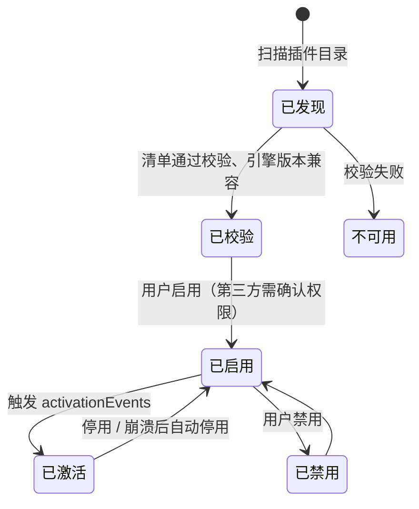

# 04 插件系统

## 设计原则

- **内置功能也是插件**。账号、作品、数据等模块全部通过插件 API 实现，和第三方插件走同一条路。
- **插件声明，宿主执行**。插件在清单里声明它要贡献什么、需要什么权限；宿主负责加载、渲染、鉴权。
- **凭据不出主进程**。插件只能请求"调用某个网易端点"，永远看不到 Cookie 和密码。
- **按风险分级开放**。先开放没有代码的主题插件，再逐步开放有代码的插件。
- **功能先成为能力**。插件的业务操作要能被 MCP 调用，不能只存在于界面里。见 [13 能力层与 MCP 接入](13-mcp.md)。

## 插件类型与信任等级

| 等级 | 类型 | 代码运行位置 | 界面渲染 | 开放阶段 |
|---|---|---|---|---|
| `builtin` | 内置插件 | 渲染进程（与 Shell 同进程） | 直接 React 组件 | 内置 |
| `theme` | 主题插件 | 无代码 | — | 第一批 |
| `declarative` | 声明式组件插件 | 插件宿主进程 | 返回界面描述，Shell 用主题组件渲染 | 第二批 |
| `custom-ui` | 自定义界面插件 | 插件宿主进程 + 沙箱 iframe | 插件自己的 HTML/JS，通过桥通信 | 第三批 |

信任等级由**安装来源**决定，不由清单自报：随应用发布的是 `builtin`，用户本地安装的第三方插件最高是 `declarative` 或 `custom-ui`。

## 插件包结构

```
my-plugin/
├─ glaze-plugin.json      清单
├─ dist/
│  ├─ ui.js               界面入口（builtin 在渲染进程加载）
│  └─ worker.js           逻辑入口（第三方插件在插件宿主进程加载）
├─ layouts/               页面默认布局
├─ locales/               多语言文案（可选）
└─ assets/                图片等资源，通过 glaze-asset:// 访问
```

第三方插件以 `.glazeplugin`（zip）分发，安装时解压到用户数据目录的 `plugins/<id>/<version>/`。

## 清单（glaze-plugin.json）

```json
{
  "id": "author.sales-board",
  "name": "销量看板",
  "version": "1.0.0",
  "publisher": "author",
  "engines": { "glaze": "^0.1.0" },
  "entries": { "ui": "dist/ui.js", "worker": "dist/worker.js" },
  "activationEvents": ["onPage:sales"],
  "contributes": {
    "pages":    [{ "id": "sales", "title": "销量看板", "defaultLayout": "layouts/sales.json" }],
    "navItems": [{ "page": "sales", "icon": "nav.analytics", "group": "top", "order": 100 }],
    "widgets":  [{ "id": "sales.top10", "title": "近 7 日销量前十", "minW": 4, "minH": 3 }],
    "commands": [{ "id": "sales.refresh", "title": "刷新销量" }],
    "settings": [{ "id": "refreshMinutes", "title": "刷新间隔（分钟）", "type": "number", "default": 10 }]
  },
  "permissions": ["netease:works.read", "netease:analytics.read", "storage"]
}
```

清单由 `@glaze/contracts` 中的 Zod schema 校验，校验失败的插件不加载，并在插件管理页显示原因。内置插件的真实清单见 `plugins/*/glaze-plugin.json`。

## 贡献点

| 贡献点 | 作用 | 备注 |
|---|---|---|
| `pages` | 注册页面 | `chrome: "none"` 表示不显示侧边栏（例如登录页） |
| `navItems` | 侧边栏入口 | `group`：`top` / `bottom`；用户可在布局编辑里调整 |
| `widgets` | 可放进页面布局的组件 | 声明最小尺寸、可配置项 schema |
| `commands` | 命令 | 出现在命令面板，可绑定快捷键 |
| `settings` | 设置项 | 宿主统一渲染到设置页的插件分区 |
| `tools` | MCP 工具 | 声明 `id`、`description`、`risk`；处理函数用 `ctx.tools.register` 注册；权限不超过插件自身 |
| `themes` | 主题包 | 主题插件只有这一项 |
| `locales` | 文案 | 可选 |

新增贡献点属于插件 API 变更，需要写 ADR 并提升 `engines.glaze` 的次版本。

> 2026-10-16 已实现：外壳由注册表驱动，新增贡献点 `navItems.section`、`settingsSections`、`homeWidgets`，`tools` 已可用，插件 UI 入口默认导出 `definePlugin(...)`。当前实际约定以 [23 插件注册表与开发](23-plugin-registry.md) 为准；`widgets`、`commands`、`settings` 仍只是声明，宿主尚未消费。

## 生命周期



- **激活事件**：`onStartup`、`onPage:<页面 ID>`、`onCommand:<命令 ID>`、`onWidget:<组件 ID>`、`onTool:<工具 ID>`。只有需要时才加载插件代码。
- **注册在激活前**：清单里的页面、导航、组件在插件激活前就已显示（标题、占位），点击后才加载代码。
- **崩溃隔离**：第三方插件进程崩溃，宿主记录错误、停用该插件，相关组件显示"插件已停止"，其他功能不受影响。

## 插件上下文 API

插件入口导出 `activate(ctx)`。`ctx` 是插件访问宿主能力的唯一入口：

| 能力 | API | 所需权限 |
|---|---|---|
| 当前账号信息 | `ctx.account.current()`、`ctx.account.onDidChange()` | `netease:account.read` |
| 网易接口 | `ctx.netease.request(endpointId, params)` | 端点声明的权限 |
| 插件私有存储 | `ctx.storage.get/set/delete` | `storage` |
| 设置 | `ctx.settings.get(id)`、`onDidChange` | 无（只能读自己的） |
| 通知 | `ctx.notify.info/warn/error` | `notifications` |
| 命令 | `ctx.commands.register(id, handler)` | 无（只能注册自己声明的） |
| MCP 工具 | `ctx.tools.register(id, handler)` | 无（只能注册自己声明的；调用时按插件权限和客户端授权取交集） |
| 事件 | `ctx.events.on("account.switched")` 等 | 无 |
| 日志 | `ctx.log.info/warn/error` | 无（自动脱敏、带插件 ID） |

渲染侧通过 SDK 提供的 hooks 使用这些能力：`useAccount()`、`useNeteaseQuery(endpointId, params)`、`useSetting(id)`、`usePluginStorage(key)`。

### 数据加载（2026-10-16 已实现）

所有插件读取宿主数据都走 SDK 的统一缓存，目标是加载无感：回到看过的页面立即显示上次结果，过期数据在后台刷新，不再整块变空。

| API | 用途 |
|---|---|
| `useHostQuery(method, params, { ttl, enabled, keepPrevious })` | 读能力的标准入口。按「账号 + 登录批次 + 是否过期 + 方法 + 参数」做键，账号之间、登录前后绝不串数据；默认 30 秒内复用，过期后保留旧数据后台刷新（`refreshing`）；参数变化时先显示上一组结果并标 `isPrevious`，新结果到达后整体替换；同键请求合并 |
| `usePrefetchHostQuery()`、`query.prefetch(next)` | 悬停、聚焦等意图出现时预热下一次读取 |
| `QueryCache` | 插件需要自管缓存（分页、详情、快照）时使用的通用读缓存：LRU 容量、TTL、同键合并、失败不当成空结果、保留最后一次成功值；`expire` 标记过期不清空，`invalidate` 直接丢弃，在途旧请求不能回填 |
| `expireHostQueries`、`clearHostQueries`、`clearQueryCaches` | 宿主写入成功后自动把同模块读取标为过期并刷新屏上数据；用户「清除本地缓存」时清空全部 `useHostQuery` 与 `QueryCache` |
| `onHostWrite(listener)` | 订阅成功的写能力调用（按能力元数据 `risk !== "read"` 判定） |
| `formatDate`、`formatDateTime`、`formatShortDateTime` | 平台时间统一按本地时区显示 |

**数据变化通知**：主进程在平台业务写入后广播 `data.changed { modules }`。写入来源包括界面 IPC 和 AI 通过 MCP 的写入；失败或结果未知的写入也会广播，因为平台可能已经改了。模块判定集中在 `apps/desktop/src/main/ipc/data-changes.ts`：读取、只暂存文件的上传/图片准备，以及应用设置都不算。界面自己发起的写入不回送给自己的窗口，由 `onHostWrite` 在本窗口刷新，避免重复请求。收到通知后，SDK 统一缓存连同依赖模块一起过期：作品变化同时影响收益、活动、分析，活动变化影响作品。屏上数据立即在后台刷新、保留旧数据，不在屏上的等下次读取再刷新；刷新前已发出的旧请求会被丢弃，不会回填旧数据。作品列表与封面、玩家评论、玩家反馈、系统消息的插件自管缓存也订阅这一事件；打开中的作品编辑页不会被替换，下次进入时重新校验。

外壳侧：侧边栏悬停或聚焦导航项时预载该页面代码；页面代码 300 毫秒内加载完成时不显示「正在加载页面…」，避免闪烁。

各插件现状：首页、分析、作品、玩家评论、收益详情原有的自建缓存已改为 `QueryCache` 或 SDK 统一缓存的薄封装（保留原接口与测试）；系统消息首页、玩家反馈改为先显示上次结果再刷新；活动推广、账号等级、关于页等直接使用 `useHostQuery` 的页面自动获得缓存。

## 权限

| 权限 | 含义 |
|---|---|
| `netease:account.read` | 读取当前账号的公开信息（昵称、头像、等级） |
| `netease:account.manage` | 登录、切换、删除账号（**仅 builtin**） |
| `netease:works.read` / `netease:works.write` | 读取 / 修改作品 |
| `netease:upload` | 上传文件到网易 |
| `netease:analytics.read` | 读取数据分析 |
| `netease:rank.read` | 读取平台排行榜（公开榜单数据） |
| `netease:income.read` / `netease:income.settle` | 读取收益 / 申请结算（结算为高危） |
| `netease:community.read` / `netease:community.write` | 读取 / 回复反馈与评论 |
| `netease:messages.read` / `netease:messages.write` | 读取 / 处理站内消息 |
| `storage` | 插件私有键值存储 |
| `notifications` | 系统通知 |
| `network:<host>` | 访问网易以外的指定域名（第三方插件自有服务） |

- 第三方插件安装或权限变更时，宿主弹窗列出权限，用户同意后才启用。
- 高危权限（`works.write`、`income.settle`、`community.write`）在每次执行前可配置为"需要确认"。
- 每次权限判定都写入审计日志（插件 ID、权限、端点、结果），设置页可查看。

## 声明式界面（declarative）

第三方插件不直接写 React，而是返回一棵受限的界面描述，由 Shell 用当前主题的组件渲染：

```ts
return ui.card({ title: "近 7 日销量前十" }, [
  ui.table({ columns: ["作品", "销量"], rows }),
  ui.button({ label: "刷新", command: "sales.refresh" }),
]);
```

可用节点：`card`、`stack`、`grid`、`text`、`stat`、`table`、`list`、`chart`、`button`、`badge`、`empty`、`error`。这样做的好处是第三方插件自动适配所有主题，也无法执行任意 DOM 操作。

## 版本与兼容

- 插件 API 跟随 `@glaze/plugin-sdk` 版本，遵循语义化版本。
- 插件通过 `engines.glaze` 声明兼容范围，不兼容的插件不加载。
- 废弃 API 至少保留一个次版本，并在开发者控制台打印警告。
