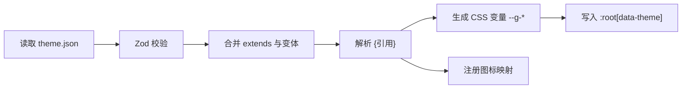

# 05 主题系统

## 目标

- 新增一套主题只需要一个主题包，不改任何组件代码。
- 主题之间可以继承，做变体（例如 Ore UI 亮色）只需覆盖少量令牌。
- 主题只改外观，不包含代码，因此用户之间分享主题包是安全的。

## 设计令牌分三层

| 层 | 例子 | 使用者 |
|---|---|---|
| 基础值 `base` | `green.600 = #3C8527` | 只在主题文件内部被引用 |
| 语义令牌 `semantic` | `surface.panel`、`text.muted`、`action.primary.bg`、`status.warning` | 绝大多数组件 |
| 组件令牌 `component` | `radius.control`、`button.edgeBottom`、`border.width`、`panel.shadow` | 具体组件的结构差异 |

规则：

- 组件代码只能读取语义令牌和组件令牌，**不能写死颜色、圆角、阴影**。由 Biome 规则和代码评审共同保证。
- 令牌值可以用 `{路径}` 引用同一主题的其他令牌，主题引擎在加载时解析。
- 不同主题的结构差异（例如 Ore UI 直角 + 按钮厚底边，Fluent 圆角 + 阴影）尽量都用组件令牌表达。

## 主题包格式

```
themes/ore-ui/
├─ theme.json     令牌、变体、图标与字体声明
├─ icons/         图标包：按语义名提供（nav.home、status.warning…）
├─ fonts/         可选字体文件
└─ overrides.css  可选，少量令牌无法表达的样式，限定在 [data-theme="<id>"] 作用域
```

`theme.json` 主要字段：

| 字段 | 说明 |
|---|---|
| `id` / `name` / `version` | 主题标识 |
| `extends` | 可选，继承另一个主题，只覆盖差异 |
| `defaultVariant` | 默认变体，例如 `dark` |
| `tokens.base/semantic/component` | 三层令牌 |
| `variants` | 变体覆盖，例如 `light` 只覆盖表面色和文字色 |
| `icons` | 图标目录和风格（`pixel` / `line`） |
| `fonts` | 字体声明 |

实际例子见 `themes/ore-ui/theme.json` 和 `themes/fluent-dark/theme.json`。

## 运行时



- 令牌转成 CSS 变量：`action.primary.bg` → `--g-action-primary-bg`。切换主题只是替换变量，不需要重启或重新加载插件。
- 图标按语义名查找：组件写 `<Icon name="nav.home" />`，当前主题提供具体图像。主题缺少某个图标时回退到内置默认图标集。
- 主题资源通过 `glaze-asset://theme/<id>/...` 协议加载，主进程校验路径不越出主题目录。
- 密度（紧凑 / 舒适）作为全局开关，通过 `space.unit` 等组件令牌缩放。

## 校验与工具

- `tools/` 提供主题校验脚本：检查必需令牌是否齐全、引用是否能解析、文字与背景对比度是否达标（正文 4.5:1）。
- 内置主题在 CI 中校验；第三方主题在安装时校验，不合格的拒绝安装并给出原因。

## Ore UI 主题的设计原则：方块语言 + 简约

首套主题参考基岩版 Ore UI，同时融入简约设计：**保留辨识度最高的方块元素，去掉多余的装饰和层级。**

| 保留（Ore UI 的辨识度） | 简化（简约） |
|---|---|
| 直角，不用圆角 | 面板只有一层，不再嵌套"面板里的凹槽" |
| 2px 实色描边 | 去掉面板的内侧高光和多余阴影 |
| 按钮底部 4px 厚边，按下时下沉 | 一个页面只有一个主色按钮，其余用次要样式 |
| 绿色作为唯一强调色 | 状态色只用于状态本身（有效、警告、失败） |
| 像素图标：导航、Logo、空状态 | 正文区不放装饰图案，背景用纯色 |
| 粗体标题 | 字号层级控制在 3–4 级，靠留白分组而不是加边框 |

这些原则会体现在 `ore-ui` 主题的令牌和 `@glaze/ui` 组件的默认样式里，设计稿按同一原则修订。

## 新增一套主题的步骤

1. 在 `themes/` 下新建目录，或者用 `extends` 继承已有主题。
2. 填写语义令牌和组件令牌，提供图标包（可只提供差异图标）。
3. 运行主题校验脚本。
4. 在设置页切换预览；内置主题随应用发布，第三方主题打包成主题插件。
