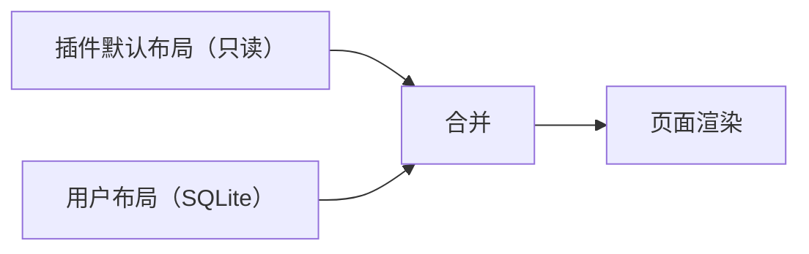

# 06 布局系统

> 2026-10-16：排版自由已移出项目范围（[PROJECT 决定 #69](../PROJECT.md)），以固定布局为准。下文的布局文档、编辑模式、拖拽缩放与组件增删不再实施，仅作历史设计保留；`@glaze/layout` 骨架不再推进。现行规则见 PROJECT 决定 #20（框大小固定）。

## 概念

| 概念 | 说明 |
|---|---|
| 页面（Page） | 插件注册的一个路由，例如 `glaze.account/account` |
| 组件（Widget） | 页面里的一个界面块，由插件注册，例如 `account.current` |
| 组件实例 | 布局里放置的某个组件，有自己的 `id`，同一组件可以放多个实例 |
| 布局文档（Layout） | 描述页面里有哪些组件实例、位置、大小和实例配置的 JSON |

## 布局文档

```json
{
  "page": "glaze.account/account",
  "version": 1,
  "columns": 12,
  "items": [
    { "id": "current", "widget": "account.current", "x": 0, "y": 0, "w": 6, "h": 4 },
    { "id": "level", "widget": "account.level", "x": 0, "y": 4, "w": 6, "h": 5 },
    { "id": "saved", "widget": "account.saved", "x": 6, "y": 0, "w": 6, "h": 5 },
    { "id": "security", "widget": "account.security", "x": 6, "y": 5, "w": 6, "h": 4, "props": {} }
  ]
}
```

- 网格为 12 列，行高固定，由 `react-grid-layout` 实现拖拽和缩放。
- `props` 是实例配置，由组件声明的 schema 校验（例如图表组件的时间跨度）。
- 窗口较窄时（小于 1100px）自动退化为单列，按 `y` 再按 `x` 排序，不需要用户另存一份窄屏布局。

## 默认布局与用户覆盖



- 插件随包提供默认布局；用户修改后保存为覆盖版本，存入 `layouts` 表。
- "恢复默认"即删除用户覆盖。
- 插件升级改了默认布局时，**不覆盖用户已改过的布局**，只把新增的组件追加到末尾，并提示用户。

## 编辑模式

- 页面右上角"编辑布局"进入编辑模式：组件出现拖拽手柄、缩放角和移除按钮。
- 侧边弹出组件库，列出所有已启用插件注册的组件，可拖进页面。
- 退出编辑模式时保存；提供撤销上一步和恢复默认。

## 导航布局

侧边栏也是一份布局：显示哪些入口、顺序、分组（顶部 / 底部）、侧边栏是否收起。插件通过 `navItems` 贡献入口，用户在设置里调整，保存方式与页面布局相同。

## 容错

- **组件失效**：布局引用的组件不存在（插件被卸载或禁用），该位置显示"组件不可用"占位，保留位置，可一键移除。
- **组件出错**：每个组件实例包在独立的错误边界里，一个组件崩溃只影响自己，显示错误和"重试"。
- **数据状态**：组件统一用 SDK 提供的加载、空、错误、部分失败四种状态展示，不允许把失败显示成空数据或零。

## 版本迁移

- 布局文档带 `version`。布局格式变化时，`@glaze/layout` 提供迁移函数，按版本逐级升级。
- 组件改名时，插件在清单里声明 `replaces` 映射，旧布局自动迁移到新组件 ID。
