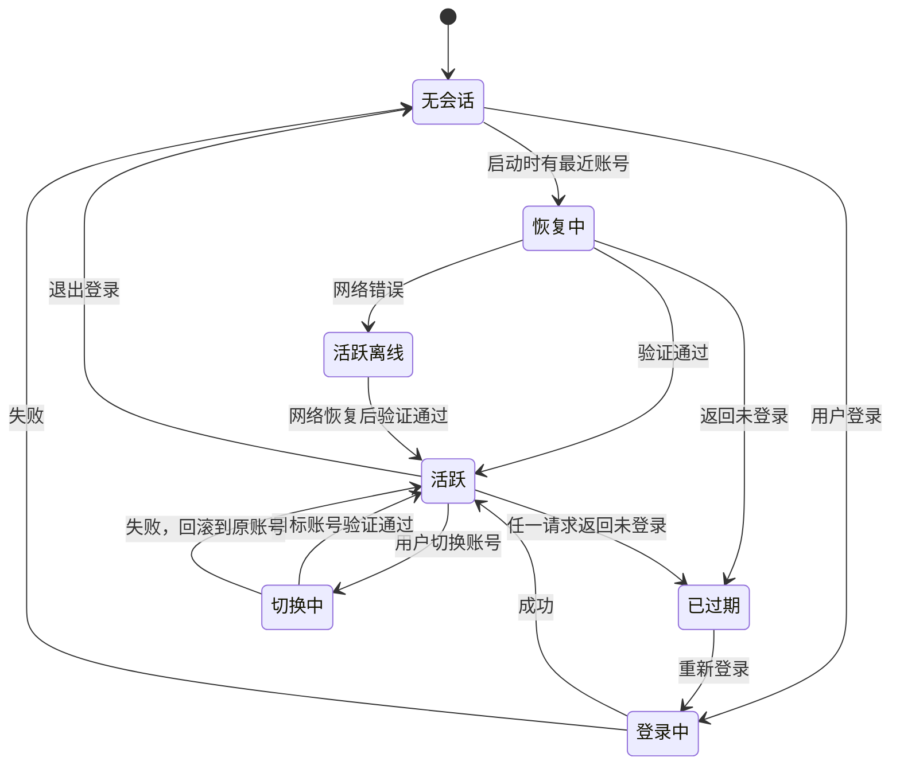
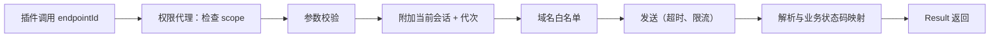

# 07 会话与网易接入

`@glaze/netease` 是唯一和网易平台打交道的包，运行在主进程。网易接口或登录协议变化时，只改这里。

## 账号身份

- 网易开发者接口（`GET /users/me`）不返回开发者 UID，所以账号用**本地 ID**（UUID）标识。
- 新登录按**通行证账号**（官方登录窗口里 `P_INFO` Cookie 的第一段，例如 `dev@163.com`）归到已有账号；Cookie 导入拿不到通行证账号，按昵称归并。
- 一个账号的数据：本地 ID、昵称、头像地址、通行证账号（可选）、登录方式（官方窗口 / Cookie）、最近登录时间、会话状态、加密的会话 Cookie。**不保存密码**（[ADR-0009](../adr/0009-official-login-window.md)）。

## 会话管理（SessionManager）

### 状态机



### 关键规则

1. **每个账号一个独立的 CookieJar**。请求时只附加当前账号的 Cookie，并且只发往网易域名白名单。
2. **切换账号串行化**：同一时间只有一个切换在进行（互斥锁）。先验证目标账号，成功后才替换当前会话；失败时保持原账号不变。
3. **会话代次（generation）**：每次切换账号，代次加一。每个请求记录发起时的代次，响应返回时代次不一致就丢弃，防止旧账号的响应写进新账号的界面。
4. **区分过期与网络错误**：只有网易明确返回未登录（401 / `no_login`）才判定过期。超时、断网不改变会话状态，只提示离线。
5. **会话回写**：响应里更新的 Cookie 写回该账号的 CookieJar，并在一定间隔或退出时加密持久化。
6. 会话变化通过事件 `account.switched`、`account.expired`、`account.loggedOut` 推送给 Shell 和插件。

## 登录协议

从原项目迁移（行为参考，代码重写）：

| 登录方式 | 流程 |
|---|---|
| 官方登录窗口 | 打开网易开发者平台登录页（一次性内存会话分区，只允许网易域名）→ 用户在网易页面登录 → 监听到 `NTES_SESS` 后读取 `P_INFO` → 关闭窗口并清空分区 → `GET /users/me` 验证 → 保存 |
| Cookie 导入 | 从粘贴的内容取出 `NTES_SESS`（整串或只有值）→ `GET /users/me` 验证 → 通过才保存 |

- 不复刻网易的邮箱密码协议，应用不经手密码，见 [ADR-0009](../adr/0009-official-login-window.md)。
- 进度通过 `login.progress` 事件推送，登录界面展示"在网易登录窗口中完成登录 / 验证账号"。
- 只发送 `NTES_SESS`；响应里轮换的 `NTES_SESS` 写回该账号的会话。
- 启动时按保存的状态直接打开页面，后台再验证当前账号；网易返回未登录才判定过期，网络错误只标为离线。

## 端点目录

所有网易接口在一处声明，按业务分文件（参考原项目的 Login、Info、Resource、Upload、Analyze、Income、Activity、Promotion、Feedback、Comment、Mailbox 等接口分组）：

```ts
export const worksList = defineEndpoint({
  id: "works.list",
  method: "GET",
  host: "mcDev",
  path: "/...",
  scope: "netease:works.read",
  params: WorksListParams,
  response: WorksListResponse,
});
```

- `id` 是插件调用时用的名字，`scope` 是所需权限，`params` / `response` 是 Zod schema。
- 主机按别名引用（`login`、`mcDev`、`upload`），实际地址集中配置，便于平台迁移时修改。
- 响应结构用宽松模式解析（允许未知字段），但必需字段缺失时视为解析错误，不填默认值。

## 请求管线



- 超时默认 15 秒，上传单独配置。
- 读请求可重试（指数退避，最多 2 次）；写请求不自动重试。
- 同一账号对同一端点的并发做限流，避免触发平台风控。
- 日志只记录端点 ID、耗时、结果类型，**不记录 Cookie、密码和完整响应体**。

## 错误模型

```ts
type NeteaseError =
  | { kind: "session_expired" }
  | { kind: "network"; cause: string }
  | { kind: "timeout" }
  | { kind: "business"; code: string; message: string }
  | { kind: "parse"; endpoint: string }
  | { kind: "forbidden"; permission: string };
```

- 所有调用返回 `Result<T, NeteaseError>`，调用方必须处理失败分支。
- 聚合类查询（例如首页收益要查多个作品）返回 `Partial<T>`：成功部分 + 失败列表。界面显示"有 N 项查询失败，结果不完整"并提供重试，**绝不把失败当作零**。

## 已接入的数据能力

主进程通过 `SessionManager.request(account, call)` 发请求：默认当前账号，指定账号时不切换界面；网易返回未登录时把该账号标为过期（界面随即跳到重新登录），网络错误标为离线，下次成功后恢复；响应轮换的 `NTES_SESS` 通过 `NeteaseSession.onRenewed` 加密存回。

| 能力 | 网易接口 | 说明 |
|---|---|---|
| `developer.level` | `GET /new_level/` | 等级、阶、经验区间、升阶任务、本月贡献 |
| `analytics.overview` | `GET /data_analysis/overview/` | 字段缺失视为解析错误，不填零 |
| `income.estimate` | `GET /items/categories/pe/`、`/data_analysis/day_detail/`、`/goods/pe/summary`、`/goods/pe/{iid}/`、`/data_analysis/goods/day_detail/` | 作品每 20 个一批查询日明细（必须带 `sort`、`order`，否则平台返回"查询日明细数据失败"），跳过前置模组；某批失败时列出这些作品名，不当作零 |
| `rank.list` | `GET /square/us_rank_list/`、`/square/rank_list/` | 手游与端游的分类编号不同；`rank_change` 是上次名次减本次名次，上次名次超出前 50 视为新上榜。只有热门飙升榜返回作品图标（`icon_url`），其余榜单只有作品 ID 和名称，`/items/categories/pe/{id}` 也查不到别人的作品，这些榜单用生成色块 |
| `works.list` | `GET /items/categories/pe/` | 只含手机版作品；列表没有封面和上线时间。收益速算也复用它（跳过 `pri_type` 为 9 的前置模组） |
| `works.get` | `GET /items/categories/pe/{id}` | 图标取 `channel` 里 `channel_id` 为 5 的图（1000×1000 正方形），`banner_pic` 是横幅图；另有上线、首次上线、定时上架时间；只能查本账号的作品 |
| `works.reviewFeedback` | `GET /items/categories/pe/{id}/feedback` | 反馈可能是 HTML，主进程转成纯文本；没有反馈时返回 null |

## 两个独立的 HTTP 客户端

| 客户端 | 用途 | 会话 |
|---|---|---|
| 网易客户端 | 所有网易接口 | 按账号附加 Cookie，只发往网易域名白名单 |
| 公共客户端 | GitHub 更新检查、插件作者的 `network:<host>` 请求 | **永远不带 Cookie** |

两个客户端不共享 Cookie 存储，从结构上杜绝原项目 Cookie 随更新请求外泄的问题。

## 业务规则

收益速算等本地规则（分成档位、补贴、统计窗口）放在 `netease` 包的纯函数模块中（`packages/netease/src/income/rules.ts`），界面上明确标注"估算"与平台结算记录的区别。边界测试等 Vitest 接入后补上。

当前规则（按参考项目的行为整理，未经网易官方文档核对）：

- 统计窗口：目标月 1 日前 9 天到下月 1 日前 10 天，例如 2026-10 为 9 月 22 日到 10 月 22 日。普通作品的钻石扣除退款率，大厅商品按所属作品汇总。
- 100 钻石计 1 元。每个作品先扣 30% 平台技术服务费，开发者基础分成按该作品流水：100 万钻以下 50%，1000 万以下 52.5%，以上 55%。
- 按总流水返还非开发者部分：10 万钻以下 50%，30 万以下 30%，50 万以下 20%，100 万以下 10%，以上 0。
- 单作品激励：10 万 / 50 万 / 100 万 / 300 万 / 500 万钻起分别为 100 / 500 / 1000 / 3000 / 5000 元，每档最多 3 个作品，超出的降一档。总流水 100 万–500 万钻奖励 200 元，500 万–1000 万奖励 1000 元。总流水达到 5000 万钻时不计任何补贴。
- 个税按劳务报酬：800 元以下不扣，4000 元以下扣（收入 − 800）× 20%，以上扣收入 × 80% × 20%。
