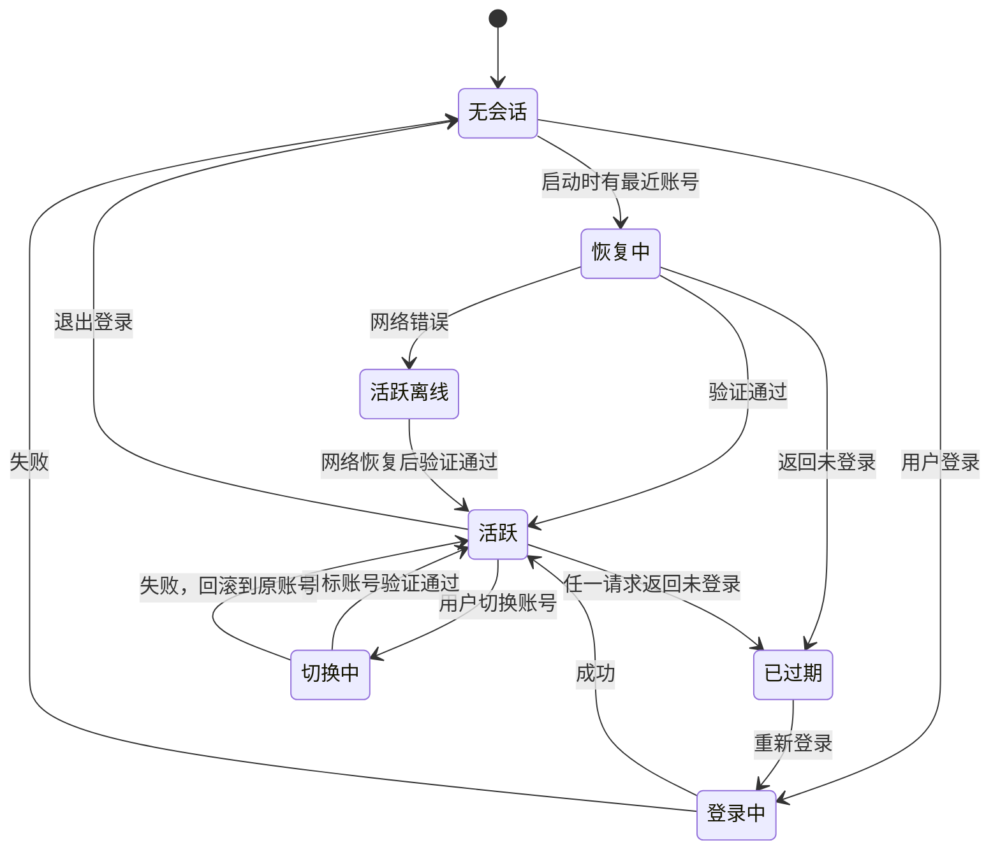

# 07 会话与网易接入

`@glaze/netease` 是唯一和网易平台打交道的包，运行在主进程。网易接口或登录协议变化时，只改这里。

## 账号身份

- 账号以网易返回的**开发者 UID** 作为唯一标识，不用昵称（原项目用昵称查找账号，改名或重名会出错）。
- 一个账号的数据：UID、昵称、头像、邮箱（可选）、登录方式、最近登录时间、加密的会话、加密的密码（仅勾选"记住密码"时）。

## 会话管理（SessionManager）

### 状态机



### 关键规则

1. **每个账号一个独立的 CookieJar**。请求时只附加当前账号的 Cookie，并且只发往网易域名白名单。
2. **切换账号串行化**：同一时间只有一个切换在进行（互斥锁）。先验证目标账号，成功后才替换当前会话；失败时保持原账号不变。
3. **会话代次（generation）**：每次切换账号，代次加一。每个请求记录发起时的代次，响应返回时代次不一致就丢弃，防止旧账号的响应写进新账号的界面。
4. **区分过期与网络错误**：只有网易明确返回未登录（401 / `no_login`）才判定过期。超时、断网不改变会话状态，只提示离线。
5. **会话回写**：响应里更新的 Cookie 写回该账号的 CookieJar，并在一定间隔或退出时加密持久化。
6. 会话变化通过事件 `account.switched`、`account.expired`、`account.loggedOut` 推送给 Shell 和插件。

## 登录协议

从原项目迁移（行为参考，代码重写）：

| 登录方式 | 流程 |
|---|---|
| 邮箱登录 | 初始化 → 获取安全验证参数 → 本地计算 VDF → 获取票据 → RSA 加密密码 → SM4 包装参数提交 → 取得 Cookie → 拉取用户资料确认 UID |
| Cookie 登录 | 解析粘贴的 Cookie（整串或目标值）→ 写入临时 CookieJar → 拉取用户资料验证 → 成功后转正 |

- 只有特定的安全校验错误会重跑整个流程，最多 3 次；其他错误直接返回给界面。
- VDF 计算可能较耗时，放在 `worker_threads` 中执行，不阻塞主进程。
- 每一步的进度通过事件推送，登录界面展示"初始化 / 安全验证 / 获取票据 / 验证账号"。
- 协议实现必须有单元测试，用录制的请求响应做回归。

## 端点目录

所有网易接口在一处声明，按业务分文件（参考原项目的 Login、Info、Resource、Upload、Analyze、Income、Activity、Promotion、Feedback、Comment、Mailbox 等接口分组）：

```ts
export const worksList = defineEndpoint({
  id: "works.list",
  method: "GET",
  host: "mcDev",
  path: "/...",
  scope: "netease:works.read",
  params: WorksListParams,
  response: WorksListResponse,
});
```

- `id` 是插件调用时用的名字，`scope` 是所需权限，`params` / `response` 是 Zod schema。
- 主机按别名引用（`login`、`mcDev`、`upload`），实际地址集中配置，便于平台迁移时修改。
- 响应结构用宽松模式解析（允许未知字段），但必需字段缺失时视为解析错误，不填默认值。

## 请求管线


- 超时默认 15 秒，上传单独配置。
- 读请求可重试（指数退避，最多 2 次）；写请求不自动重试。
- 同一账号对同一端点的并发做限流，避免触发平台风控。
- 日志只记录端点 ID、耗时、结果类型，**不记录 Cookie、密码和完整响应体**。

## 错误模型

```ts
type NeteaseError =
  | { kind: "session_expired" }
  | { kind: "network"; cause: string }
  | { kind: "timeout" }
  | { kind: "business"; code: string; message: string }
  | { kind: "parse"; endpoint: string }
  | { kind: "forbidden"; permission: string };
```

- 所有调用返回 `Result<T, NeteaseError>`，调用方必须处理失败分支。
- 聚合类查询（例如首页收益要查多个作品）返回 `Partial<T>`：成功部分 + 失败列表。界面显示"有 N 项查询失败，结果不完整"并提供重试，**绝不把失败当作零**。

## 两个独立的 HTTP 客户端

| 客户端 | 用途 | 会话 |
|---|---|---|
| 网易客户端 | 所有网易接口 | 按账号附加 Cookie，只发往网易域名白名单 |
| 公共客户端 | GitHub 更新检查、插件作者的 `network:<host>` 请求 | **永远不带 Cookie** |

两个客户端不共享 Cookie 存储，从结构上杜绝原项目 Cookie 随更新请求外泄的问题。

## 业务规则

收益速算等本地规则（分成档位、补贴、统计窗口）放在 `netease` 包的纯函数模块中，带版本号和边界测试。界面上明确标注"估算"与平台结算记录的区别。
