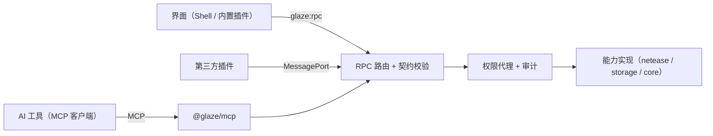

# 13 能力层与 MCP 接入

让外部 AI 工具（Claude Code、Codex、Cursor 等）通过 MCP 使用本应用的功能。应用本身不内置 AI。决定见 [ADR-0008](../adr/0008-capabilities-and-mcp.md)。

## 核心原则：能力优先

每个业务功能都先定义成一个**能力**，再做界面。界面、插件、MCP 是同一份能力的三个调用方：



设计每个功能时都要回答这几个问题：

| 问题 | 写在哪里 |
|---|---|
| 这个功能对应哪些能力？参数和返回值是什么？ | `@glaze/contracts` 的方法定义 |
| 需要什么权限？风险等级是什么？ | 方法定义的 `permission`、`risk` |
| 要不要给 AI 用？AI 需要知道什么才能用对？ | 方法定义的 `mcp` 字段 |
| 失败时 AI 收到什么？ | 统一错误模型，`kind` 映射为 MCP 错误 |

**不允许出现"只有界面能做"的业务逻辑。** 界面里的计算（例如收益汇总）也要放进能力实现，界面只负责展示。

## 能力定义

在 [09 IPC 与契约](09-ipc-and-contracts.md) 的 `method()` 上增加两个字段：

```ts
"works.list": method({
  params: z.object({ account: Uid.optional(), page: z.number().int().min(1).default(1) }),
  result: Page(WorkSummary),
  permission: "netease:works.read",
  risk: "read",
  mcp: {
    expose: true,
    title: "列出作品",
    description: "列出指定账号的作品（默认当前账号），包含审核状态、上架状态和最近更新时间。",
  },
}),
```

| 字段 | 取值 | 说明 |
|---|---|---|
| `risk` | `read` / `write` / `dangerous` | 决定 MCP 调用是否需要确认 |
| `mcp.expose` | 布尔 | 是否映射为 MCP 工具，默认 `false` |
| `mcp.title` / `description` | 文本 | 写给 AI 看：做什么、默认值、返回什么、什么时候不该用 |
| `mcp.resource` | URI 模板（可选） | 同时作为 MCP 资源暴露，例如 `glaze://works/{id}` |

以下能力**永远不对 MCP 开放**，契约校验时强制检查：

- `caller: "shell"` 的方法（启动路由、窗口控制等）。
- `netease:account.manage`：登录、导入 Cookie、删除账号、读取任何凭据。

## 映射规则

| 能力 | MCP 对应 | 命名 |
|---|---|---|
| 内置方法 | 工具（tool） | 点换成下划线：`works.list` → `works_list` |
| 插件贡献的工具 | 工具 | `plugin_<插件短名>_<工具名>` |
| 带 `mcp.resource` 的只读方法 | 资源（resource） | `glaze://account/current`、`glaze://works/{id}` |

- 返回值：成功时同时给出结构化内容（JSON）和一段简短文字摘要。
- 失败时：返回 `isError: true`，正文写明 `kind`（`session_expired`、`network`、`forbidden` 等）和可读原因。**失败不能返回空列表或零值**，和界面规则一致。
- 部分成功（例如收益汇总有一个月查询失败）：返回已有数据，并在结果里列出缺失项。

## 多账号

- 工具参数里的 `account` 可选，默认当前账号。
- 指定其他账号时直接使用该账号的会话，**不切换界面上的当前账号**。会话管理按账号（本地 ID）各自持有 Cookie，本来就支持。
- 提供 `account_list` 工具，只返回本地 ID、昵称、通行证账号、会话状态，不含任何凭据。

## 传输与启动

| 方式 | 用途 | 默认 |
|---|---|---|
| stdio | AI 工具最通用的接入方式。AI 工具启动 `GlazeMCDevManager.exe --mcp`，这个进程不开窗口，只把 stdio 转发给正在运行的应用 | 开启 MCP 后可用 |
| 本机命名管道 | `--mcp` 桥进程与主应用之间的通道：`\\.\pipe\glaze-mcp-<用户 SID>`，只允许当前 Windows 用户连接 | — |
| Streamable HTTP | 只监听 `127.0.0.1`，带访问令牌；给只支持 HTTP 的客户端 | 关闭 |

设置页"MCP 接入"提供：总开关、已配对客户端列表、一键复制 Claude Code / Codex / Cursor 的配置片段。

应用没有运行时 `--mcp` 的行为见"待定事项"。

## 安全

MCP 客户端是新的调用者身份，走同一个权限代理：

```ts
type CallerIdentity =
  | { type: "shell" }
  | { type: "plugin"; pluginId: string; trust: "builtin" | "declarative" | "custom-ui" }
  | { type: "mcp"; clientId: string; clientName: string };
```

| 措施 | 规则 |
|---|---|
| 配对 | 新客户端第一次连接时，应用弹窗显示客户端名称，用户同意后才能调用；可随时撤销 |
| 授权范围 | 按权限授予，默认只给只读权限（`*.read`）；写权限要用户单独勾选 |
| 确认 | `write`：默认每次在应用内确认，可设为"本次连接内允许"；`dangerous`（如申请结算）：每次都必须确认，不能免确认 |
| 凭据 | 永远不返回 Cookie、密码、ticket；工具结果再过一遍日志脱敏规则 |
| 审计 | 每次调用写 `audit_log`：客户端、工具、账号、结果 |
| 限流 | 每个客户端有调用频率上限，避免 AI 循环调用把账号刷到风控 |

## 插件贡献工具

插件清单新增贡献点 `tools`：

```json
"tools": [
  { "id": "top10", "title": "近 7 日销量前十", "description": "返回当前账号近 7 日销量最高的 10 个作品", "risk": "read" }
]
```

- 处理函数通过 `ctx.tools.register(id, handler)` 注册，参数和返回值用插件自带的 JSON Schema 声明。
- 工具能用的权限不超过插件已获得的权限，同时受 MCP 客户端授权范围约束（取交集）。

## 每个模块的 MCP 清单

模块开发时在这里补充它暴露的工具，作为验收的一部分。

| 模块 | 计划暴露的工具 | 风险 |
|---|---|---|
| 账号 | `account_list`、`account_current`（能力已在 `@glaze/contracts` 的 `capabilities` 定义，MCP 服务待接入）；等级卡片与首页共用 `developer_level` / `developer.level`，支持按 `account` 读取等级、经验、升阶任务及两类贡献；`sessionSettings.get/set` 已定义为主界面专用读/写能力（`netease:account.read/manage`），管理自动登录与过期提醒，暂不开放 MCP；登录、Cookie 导入、切换、退出、删除永不开放 | read；会话偏好写入仅主界面 |
| 首页 | `developer_level`（等级、阶、经验、贡献）、`analytics_overview`（本月 / 上月、昨日 / 14 日均的钻石与下载）、`income_estimate`（收益速算，month 可选）、`rank_list`（4 个榜单，热搜不分类，其余支持 4 个分类的前 N 条）、`rank_page`（start/limit 逐批读取，返回 items/total/nextStart，nextStart 为 null 结束）；能力已定义并接入界面，均可选 `account` 参数，MCP 服务待接入 | read |
| 作品 | 已声明 `works_list`、`works_get`、`works_review_feedback`；本轮设计增加编辑文档、选项查询、创建/修改草稿、材料上传、保存与提交审核，详见下节。所有 MCP 接入仍待实现；独立上架、删除等不在本轮范围 | read / write |
| 数据分析 | `analytics_query` | read |
| 收益 | `income_summary`、`income_monthly`（`income_estimate` 见首页）；`income_settle` | read；dangerous |
| 反馈与评论 | 已接入 `feedback.list`、`feedback.reply`、`feedback.log`、`comments.list`、`comments.reply`，仅供应用主界面调用；MCP 的 `community_list`、`community_reply` 暂未暴露，详见 [玩家反馈数据接入](player-feedback-data.md) 与 [玩家评论数据接入](player-comments-data.md) | read / write |
| 消息 | `messages_list`、`messages_mark_read` | read / write |

### 作品列表八项能力（2026-10-16）

应用已定义并接入 `works.cancelReview`、`works.publish`、`works.appointOnline`、`works.cancelAppointOnline`、`works.submitSelfTest`、`works.cancelTest`、`works.delete`、`works.changePrice`。权限均为 `netease:works.write`; 删除风险为 `dangerous`, 其他为 `write`。目前均为 `shellOnly`, 没有 MCP exposure; 上表关于独立上架和删除未开放 MCP 的范围保持不变。取消定时上架只允许 `appoint_online`, 发送显式 null 清除预约。

能力接收固定账号、作品 ID 和预期状态; 自测额外携带免机审选择, 定时上架携带北京时间, 调价携带原币种/价格与新价格。主进程对参数、调用窗口、账号、作品实时状态和价格规则进行校验, 同一账号/作品的列表写操作互斥。所有八项操作都经过应用内确认, 不自动重试写入; 无法判断写结果时返回 `outcome: uncertain`, 界面要求核对后再操作。未来 MCP 接入必须复用这些校验并接入批准机制, 不能直接开放现有 IPC。


## 作品创建、更新与提交审核（2026-10-16 设计，尚未实现）

用户要求 MCP 支持作品更新、提交审核，以及作品创建/编辑页的内容填写和修改。只读连接可以作为开发检查点，但不能作为本轮功能完成标准。范围决策见 [ADR-0012](../adr/0012-mcp-work-editing.md)。

### 编辑范围

以 `workSections`、`workCreateFields` 和实时 `works.options` 为来源，复用作品服务的校验、合并和平台适配器。以下是拟开放范围，不表示当前 MCP 已可调用。

| 页面分区 | AI 可填写或修改 | 限制 |
|---|---|---|
| 基本信息 | 名称、专区、原创标记、标签、活动说明、授权证明、关联模组与 PC 同步开关 | ID、模组码、审核状态等只读；新建的更新专用配置按两步流程应用，不猜测新 ID |
| 资源定价 | 平台允许的定价类型、价格与档位 | 读取实时选项，确认页突出价格变更 |
| 详情与攻略 | PE 详情富文本、详情图片 | 富文本经过白名单清理；已有攻略只读，攻略上传/编辑协议尚未接入 |
| 资源文件 | 分类、modAPI 版本、推荐标签、坐骑功能、资源包及提升版本选项、前置依赖、畅玩计划、联机大厅 | 文件必须经过受控材料流程；新建前置模组须核对账号开关，且强制免费 |
| 图片与视频 | 平台图片位、推广广图、视频及封面 | 按实际选项校验尺寸、文件类型及视频约束 |
| 更新与上架 | 更新纪要、弱下架开关及原因 | 弱下架字段不等于独立的立即上架/定时上架操作 |
| PC 同步 | 已有作品的 PC 名称、简介、详情、分类、适用范围、地图标记、标签、图片、弱下架设置 | 只开放当前编辑器已有字段，不承诺独立 PC 作品创建或任意 PC 文件上传 |

### 工具方案

以下名称为设计接口，注册时必须有明确参数/输出 Schema、权限和调用者校验。不得只把当前 `shellOnly` 方法改成 `any` 就视为接入完成。

| 工具 | 行为 |
|---|---|
| `works_editor` | 读取已授权作品的可编辑文档、状态和基线快照标识 |
| `works_options` | 查询当前账号的分类、标签、价格、版本和媒体要求 |
| `works_draft_create` | 为新作品或已有作品创建隔离的本地草稿，绑定客户端、账号和作品 |
| `works_draft_patch` | 按分区修改明确字段；不自动补写 AI 未要求修改的字段 |
| `works_draft_validate` | 校验必填项、状态、选项和材料，返回定位到具体字段的问题 |
| `works_draft_preview` | 返回变更摘要，并在应用内打开与作品编辑页一致的预览 |
| `works_asset_import` | 请求导入用户选择或已授权目录内的材料，返回不透明材料 ID |
| `works_asset_upload` | 经上传授权后上传固定材料，签名回执仅供宿主保存操作使用 |
| `works_create` / `works_save` | 为已校验草稿建立一次性写入请求，等待应用内确认后创建/保存 |
| `works_submit_review` | 为确定的作品内容建立提审请求；校验状态后等待应用内确认 |
| `works_operation_get` | 查询待确认、执行中、成功、失败、结果未知或需要平台处理的操作 |

工具通过注入的能力执行器复用当前业务服务，不直接调用依赖窗口事件的 Electron IPC handler。原生材料选择、确认和预览由宿主 UI 适配。草稿拥有独立修订号；AI 草稿不覆盖用户正在编辑的本地草稿。用户在应用内调整 AI 草稿后返回新修订号，原有审批失效。

### 材料上传

默认由用户在应用内选择文件；批量自动化可在应用内明确授予某客户端对指定素材目录的读取权限。AI 提交相对路径，由主进程规范化并检查最终实际路径，拒绝越界、符号链接/重解析点逃逸、设备路径及未授权网络路径。不得提供任意磁盘读取或任意 URL 下载工具。

导入生成有期限、按客户端/账号/草稿绑定的材料 ID，保存文件名、大小、内容哈希与用途。上传时固定同一份内容（受控快照或稳定句柄），内容变化需要重新导入和批准。大资源文件使用流式处理，不能通过 MCP 搬运整份 Base64 文件。上传本身会把文件发到外部平台，因此读取目录授权不等于上传授权；确认页展示目的、文件名和大小。

AI 的字段修改引用材料 ID；主进程内部解析平台签名回执，不接受 AI 伪造回执。已有平台媒体仅允许引用该作品中已经存在的材料。临时材料清理与业务日志清理分离，不删除用户源文件。

### 保存和提审

1. 读取作品及实时选项，建立账号与作品固定的草稿和基线。
2. 修改字段、准备材料、完成校验，应用内展示字段差异和最终预览。
3. 用户选择“仅保存”或明确的“保存并提交审核”。审批绑定客户端、账号、作品、草稿修订、操作序列及材料哈希；单纯的 MCP 参数 `confirm: true` 不能代替批准。
4. 执行前再次核对权限、插件状态、作品状态和最新字段。被编辑字段发生冲突时返回冲突明细，重新生成差异并确认；未修改字段保留平台最新值。
5. 先保存，再独立提交审核。“保存并提审”可以一次批准这两个确定的步骤，仍分别记录结果。提审前重新核对与审核有关的内容快照，发生变化则停止并重新确认，不能提审其他客户端后来修改的内容。
6. 返回准确阶段：例如保存成功但提审失败，或平台要求额外审核确认。超时且无法判断结果时标记 `unknown`，禁止自动重试写入。

提审属于每次必须明确确认的操作，不提供本连接免确认。批准仅能从可信应用界面发起；客户端撤销、服务关闭、账号退出或草稿变化均使未执行审批失效。已发送到平台的写入不能承诺撤回，应核对实际结果。

请求使用按客户端与账号隔离的操作 ID/幂等键和持久化执行记录，避免 AI 重试或应用重启重复创建/提审。写请求发出前记录状态；重启时未完成记录按结果未知处理。对外返回待确认状态并通过 `works_operation_get` 查询，不让一次调用无限等待用户确认。

平台没有原子 revision/If-Match 协议，本地基线检查仍存在读写间的短暂竞态。新建接口也不保证返回 ID：创建成功后若无法确定 ID，应返回 `created_id_unresolved` 并由用户确认列表中的作品，不按名称猜 ID，不自动对猜测对象提审。

### 验收与边界

- 覆盖新建草稿、修改现有作品、替换资源包和媒体、仅保存、保存并提审、拒绝/超时/撤销、并发修改、写入结果未知及重试去重。
- 校验账号越权、客户端之间草稿/材料隔离、目录逃逸、确认后文件变更、伪造上传回执，以及保存后提审前作品内容变化。
- 使用协议桩和测试客户端验收，不用真实作品自动执行创建、上传或提审。真实业务验收须由用户选定作品与提交内容。
- 攻略编辑/上传、删除作品、取消审核、自测、立即上架和定时上架不列为本轮已支持能力。
- 当前页面写入逻辑尚未完成真实平台端到端验收，MCP 适配不能把这一限制隐藏为已验证。

## 待定事项

### 活动推广能力（2026-10-16）

轮播体验重设计新增 `promotion.prepareImage`（`netease:promotion.write`, read）、`promotion.uploadImage`（同权限, write）、`promotion.discardImage`（同权限, write），均为 shellOnly，不开放 MCP。原生选择与本地快照预览不上传；确认裁剪后按 940 × 450 上传，令牌由宿主绑定账号和窗口，复用既有图片校验。

新增 `promotion.activities`、`promotion.discount`、`promotion.module`、`promotion.dates`、`promotion.applications` 五个只读能力（`netease:promotion.read`），带 MCP 名称与参数说明元数据；分页 page 从 0 开始，每页 10 条，account 可选。新增 `promotion.join`、`promotion.cancelDiscount`、`promotion.saveBanner`、`promotion.upload` 四个写能力（`netease:promotion.write`），均为 shellOnly，不直接暴露给 AI。原生上传入口不接受任意本地路径。页面确认、当前账号校验、插件停用拦截和单次请求共用宿主实现。实现与本地验证见 [21 活动推广](21-promotion.md)，真实平台写入未做端到端验收；元数据不等于 MCP 传输与授权服务已经实装。

### 已接入应用的详情扩展能力（2026-10-16）

`works.searchReferences`（`netease:works.read`, read）按 PE 前置、PC 前置或关联作品的专用资源池搜索, 最多返回 20 条, 长整数 ID 始终为字符串。`works.options` 补充账号前置权限及联机大厅分类。扩展字段复用 `works.save`/`works.create` 的白名单、基线与主进程校验。

图片分为 `works.prepareImage`（`netease:works.write`, read, 原生选择并生成本地预览）、`works.uploadCroppedImage`（同权限, write, 按矩形裁剪后上传）、`works.discardImage`（同权限, write, 释放本地快照）。全部仍为 shellOnly, 无 MCP exposure。裁剪令牌绑定窗口与账号, 五分钟有效, 不接受任意路径或渲染层提供的图片字节。未来 AI 材料流程须通过授权导入适配这些能力, 不能直接开放原生选择器接口。

新建草稿允许 PC 同步、关联、授权和折扣配置, 但创建协议未声明的更新字段不能伪造写入。保留待应用配置, 创建成功后显式选定准确作品并展示确认, 再调用 `works.save`; 不根据名称猜测 ID, 不自动提审。当前 UI 草稿只在应用进程内保留, 不等价于上文未来 MCP 的持久化操作记录。

资源拖入使用 `works.uploadDroppedResource`（`netease:works.write`, write, shellOnly, 无 MCP exposure）。能力参数为账号、可选作品 ID 和草稿资源类别; 专用 preload `uploadDroppedResource(File, params)` 使用 Electron `webUtils.getPathForFile` 解析实际磁盘文件, 普通 `rpc` 入口拒绝此方法, 不接受渲染层传来的路径字符串或合成 File。内部路径仅在 preload 与主进程之间传递。主进程复核主窗口、账号、文件及实时类别规则, 复用 `works.upload` 的上传实现。未来 MCP 材料导入必须走授权文件能力, 不直接调用此桥。

| 事项 | 选项 | 计划决定时间 |
|---|---|---|
| 应用没运行时调用 `--mcp` | 自动后台启动（托盘） / 返回"请先打开应用" | M1 实现 MCP 骨架时 |
| 打包后 `--mcp` 桥的形式 | 应用本体带参数启动 / 单独的小可执行文件 | M1 实现 MCP 骨架时 |

活动报名输入同步（2026-10-16）：沿用 `promotion.join` 与 `promotion.upload`，不新增独立界面业务通道。作品活动报名的 `intro` 接收非空富文本，`images` 最多 3 个签名回执，`videos` 最多 1 个；契约校验同时作用于宿主与平台适配入口。折扣特卖的可选说明保持原规则，能力权限与开放范围不变。
