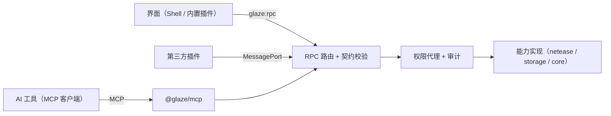

# 13 能力层与 MCP 接入

让外部 AI 工具（Claude Code、Codex、Cursor 等）通过 MCP 使用本应用的功能。应用本身不内置 AI。决定见 [ADR-0008](../adr/0008-capabilities-and-mcp.md)。

## 核心原则：能力优先

每个业务功能都先定义成一个**能力**，再做界面。界面、插件、MCP 是同一份能力的三个调用方：



设计每个功能时都要回答这几个问题：

| 问题 | 写在哪里 |
|---|---|
| 这个功能对应哪些能力？参数和返回值是什么？ | `@glaze/contracts` 的方法定义 |
| 需要什么权限？风险等级是什么？ | 方法定义的 `permission`、`risk` |
| 要不要给 AI 用？AI 需要知道什么才能用对？ | 方法定义的 `mcp` 字段 |
| 失败时 AI 收到什么？ | 统一错误模型，`kind` 映射为 MCP 错误 |

**不允许出现"只有界面能做"的业务逻辑。** 界面里的计算（例如收益汇总）也要放进能力实现，界面只负责展示。

## 能力定义

在 [09 IPC 与契约](09-ipc-and-contracts.md) 的 `method()` 上增加两个字段：

```ts
"works.list": method({
  params: z.object({ account: Uid.optional(), page: z.number().int().min(1).default(1) }),
  result: Page(WorkSummary),
  permission: "netease:works.read",
  risk: "read",
  mcp: {
    expose: true,
    title: "列出作品",
    description: "列出指定账号的作品（默认当前账号），包含审核状态、上架状态和最近更新时间。",
  },
}),
```

| 字段 | 取值 | 说明 |
|---|---|---|
| `risk` | `read` / `write` / `dangerous` | 决定 MCP 调用是否需要确认 |
| `mcp.expose` | 布尔 | 是否映射为 MCP 工具，默认 `false` |
| `mcp.title` / `description` | 文本 | 写给 AI 看：做什么、默认值、返回什么、什么时候不该用 |
| `mcp.resource` | URI 模板（可选） | 同时作为 MCP 资源暴露，例如 `glaze://works/{id}` |

以下能力**永远不对 MCP 开放**，契约校验时强制检查：

- `caller: "shell"` 的方法（启动路由、窗口控制等）。
- `netease:account.manage`：登录、导入 Cookie、删除账号、读取任何凭据。

## 映射规则

| 能力 | MCP 对应 | 命名 |
|---|---|---|
| 内置方法 | 工具（tool） | 点换成下划线：`works.list` → `works_list` |
| 插件贡献的工具 | 工具 | `plugin_<插件短名>_<工具名>` |
| 带 `mcp.resource` 的只读方法 | 资源（resource） | `glaze://account/current`、`glaze://works/{id}` |

- 返回值：成功时同时给出结构化内容（JSON）和一段简短文字摘要。
- 失败时：返回 `isError: true`，正文写明 `kind`（`session_expired`、`network`、`forbidden` 等）和可读原因。**失败不能返回空列表或零值**，和界面规则一致。
- 部分成功（例如收益汇总有一个月查询失败）：返回已有数据，并在结果里列出缺失项。

## 多账号

- 工具参数里的 `account` 可选，默认当前账号。
- 指定其他账号时直接使用该账号的会话，**不切换界面上的当前账号**。会话管理按 UID 各自持有 Cookie，本来就支持。
- 提供 `account_list` 工具，只返回 UID、昵称、会话状态，不含任何凭据。

## 传输与启动

| 方式 | 用途 | 默认 |
|---|---|---|
| stdio | AI 工具最通用的接入方式。AI 工具启动 `GlazeMCDevManager.exe --mcp`，这个进程不开窗口，只把 stdio 转发给正在运行的应用 | 开启 MCP 后可用 |
| 本机命名管道 | `--mcp` 桥进程与主应用之间的通道：`\\.\pipe\glaze-mcp-<用户 SID>`，只允许当前 Windows 用户连接 | — |
| Streamable HTTP | 只监听 `127.0.0.1`，带访问令牌；给只支持 HTTP 的客户端 | 关闭 |

设置页"MCP 接入"提供：总开关、已配对客户端列表、一键复制 Claude Code / Codex / Cursor 的配置片段。

应用没有运行时 `--mcp` 的行为见"待定事项"。

## 安全

MCP 客户端是新的调用者身份，走同一个权限代理：

```ts
type CallerIdentity =
  | { type: "shell" }
  | { type: "plugin"; pluginId: string; trust: "builtin" | "declarative" | "custom-ui" }
  | { type: "mcp"; clientId: string; clientName: string };
```

| 措施 | 规则 |
|---|---|
| 配对 | 新客户端第一次连接时，应用弹窗显示客户端名称，用户同意后才能调用；可随时撤销 |
| 授权范围 | 按权限授予，默认只给只读权限（`*.read`）；写权限要用户单独勾选 |
| 确认 | `write`：默认每次在应用内确认，可设为"本次连接内允许"；`dangerous`（如申请结算）：每次都必须确认，不能免确认 |
| 凭据 | 永远不返回 Cookie、密码、ticket；工具结果再过一遍日志脱敏规则 |
| 审计 | 每次调用写 `audit_log`：客户端、工具、账号、结果 |
| 限流 | 每个客户端有调用频率上限，避免 AI 循环调用把账号刷到风控 |

## 插件贡献工具

插件清单新增贡献点 `tools`：

```json
"tools": [
  { "id": "top10", "title": "近 7 日销量前十", "description": "返回当前账号近 7 日销量最高的 10 个作品", "risk": "read" }
]
```

- 处理函数通过 `ctx.tools.register(id, handler)` 注册，参数和返回值用插件自带的 JSON Schema 声明。
- 工具能用的权限不超过插件已获得的权限，同时受 MCP 客户端授权范围约束（取交集）。

## 每个模块的 MCP 清单

模块开发时在这里补充它暴露的工具，作为验收的一部分。

| 模块 | 计划暴露的工具 | 风险 |
|---|---|---|
| 账号 | `account_list`、`account_current` | read |
| 作品 | `works_list`、`works_get`、`works_update_info` | read / write |
| 数据分析 | `analytics_query` | read |
| 收益 | `income_summary`、`income_monthly`；`income_settle` | read；dangerous |
| 反馈与评论 | `community_list`、`community_reply` | read / write |
| 消息 | `messages_list`、`messages_mark_read` | read / write |

## 待定事项

| 事项 | 选项 | 计划决定时间 |
|---|---|---|
| 应用没运行时调用 `--mcp` | 自动后台启动（托盘） / 返回"请先打开应用" | M1 实现 MCP 骨架时 |
| 打包后 `--mcp` 桥的形式 | 应用本体带参数启动 / 单独的小可执行文件 | M1 实现 MCP 骨架时 |
