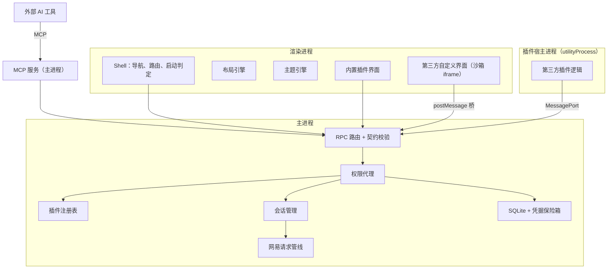

# GlazeMCDevManager 架构文档

GlazeMCDevManager（显示名 Glaze MC Dev Manager）是面向网易我的世界开发者的 Windows 桌面管理工具。业务范围参考 [MCDevManager](https://github.com/BitterLemonn/MCDevManager)，在此基础上重新设计为**宿主 + 插件**的模块化架构：排版可自由调整，主题可多套扩展，允许第三方开发插件。

## 一页概览

| 维度 | 决定 |
|---|---|
| 平台 | 仅 Windows 桌面端 |
| 技术栈 | Electron + React + TypeScript，pnpm workspaces + Turborepo 单仓库 |
| 核心结构 | 宿主（Shell）只提供窗口、导航、布局、主题、插件管理和核心服务；所有业务功能都是插件 |
| 插件 | 内置功能与第三方插件使用同一套插件 API；第三方插件按信任等级隔离运行 |
| 排版 | 页面由组件（Widget）组成，位置由布局文档描述，用户可拖拽、缩放、增删并恢复默认 |
| 主题 | 三层设计令牌 + 主题包；首套主题为 Ore UI（方块语言 + 简约） |
| 凭据安全 | Cookie、密码只存在主进程，加密落盘；插件和渲染进程永远拿不到 |
| 网易接口 | 端点目录 + 请求管线，统一错误模型，失败不会被当作零值 |
| AI 接入 | 每个功能先定义为能力；外部 AI 工具通过 MCP 在配对授权后调用，应用不内置 AI |

## 文档目录

| 文档 | 内容 |
|---|---|
| [01 总览](01-overview.md) | 背景、目标与非目标、约束、质量属性、术语 |
| [02 进程模型与启动流程](02-process-model.md) | Electron 各进程职责、通信方式、启动路由判定 |
| [03 模块与依赖规则](03-modules.md) | 仓库结构、各包职责、分层依赖约束 |
| [04 插件系统](04-plugin-system.md) | 插件清单、贡献点、生命周期、上下文 API、权限、隔离 |
| [05 主题系统](05-theme-system.md) | 设计令牌、主题包格式、运行时、Ore UI 设计原则 |
| [06 布局系统](06-layout-system.md) | 页面、组件、布局文档、编辑模式、存储与迁移 |
| [07 会话与网易接入](07-session-and-netease.md) | 账号身份、会话状态机、登录协议、请求管线、错误模型 |
| [08 数据与存储](08-data-storage.md) | SQLite 表设计、迁移、加密字段、缓存策略 |
| [09 IPC 与契约](09-ipc-and-contracts.md) | RPC 设计、契约定义、调用者身份、事件推送 |
| [10 安全](10-security.md) | Electron 安全基线、威胁模型、插件权限 |
| [11 工程规范](11-engineering.md) | 工具链、测试策略、CI、发布、代码与提交规范 |
| [12 路线图](12-roadmap.md) | 里程碑与验收标准 |
| [13 能力层与 MCP 接入](13-mcp.md) | 能力优先原则、能力到 MCP 工具的映射、传输、配对授权、每个模块的工具清单 |

项目目标、已敲定的决定和当前进度见 [docs/PROJECT.md](../PROJECT.md)。架构决策记录（ADR）见 [docs/adr](../adr/README.md)。设计参考图见 [docs/design/references](../design/references/)。

## 维护约定

- 架构文档描述"应该是什么样"。实现与文档不一致时，要么改实现，要么先改文档并补一条 ADR。
- 新增包、插件贡献点、权限、IPC 通道，都要同步更新对应文档。
- 新增业务功能时，同时在 [13 能力层与 MCP 接入](13-mcp.md) 的模块工具清单里登记它的能力和 MCP 暴露方式。
